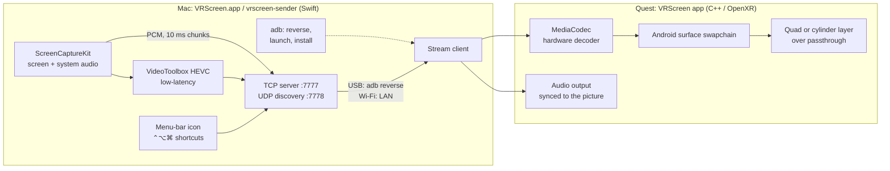

# VRScreen

**Mac screen mirroring for Meta Quest.** Your Mac's display floats in front of you as a large,
sharp screen over passthrough, so you keep seeing your room, your keyboard and your mouse.
Over a USB cable or Wi-Fi, with about 25 ms from capture to decoded frame at 4K.

- **Native on both ends**: a Swift sender on the Mac (ScreenCaptureKit + VideoToolbox HEVC) and a
  C++ OpenXR app on the headset that decodes with the hardware decoder straight into a compositor
  layer: no extra render pass, so text stays as sharp as the headset allows.
- **USB or Wi-Fi**, chosen automatically: the headset tries the cable first and otherwise finds
  the Mac on the local network. Pulling the cable mid-session falls over to Wi-Fi.
- **A menu-bar app**, VRScreen.app: flat or curved screen, **dimmable surroundings**, video
  quality, controls and the headset app, all from its menu. It sets up the USB tunnel and
  starts the headset app by itself, and tells you what's wrong and how to fix it (a
  missing permission, USB debugging not accepted, an outdated headset app...).
- **The Mac's sound in the headset**, in sync with the picture (on by default; optionally
  mutes the Mac's speakers while mirroring).
- **Place the screen without leaving the keyboard**: ⌃⌥⌘ + arrows / mouse / scroll. Or grab it with
  a controller grip, or with your hands (pinch and hold, two hands to resize).
- **Travel mode helper**: the menu shows the headset's travel-mode state and opens Quick Settings
  in the headset, for trains and planes.

View-only: you keep using your real keyboard and mouse, which you see through passthrough.

## How it works



The headset acknowledges every frame it hands to its decoder, and the Mac keeps at most three
frames in flight, so a slow link drops intermediate frames instead of building up delay. Sound
travels on the same connection as uncompressed 48 kHz stereo in 10 ms chunks, stamped with the
same capture clock as the frames; it never waits for the video window, and chunks more than
150 ms late are dropped. The full wire protocol is in [`docs/protocol.md`](docs/protocol.md).

## Requirements

| | Tested | Notes |
|---|---|---|
| Mac | Apple Silicon, macOS 27 | Uses the real-time HEVC encoder. Intel Macs are untested. |
| Headset | Meta Quest 3, Horizon OS build 209 | Quest 3S / Pro / 2 are declared in the manifest but untested. |
| USB | Android platform-tools (`adb`) | Optional: without it, Wi-Fi only. |
| Building | Xcode Command Line Tools (Swift 6), Homebrew; JDK 17, Android SDK platform 36, build-tools 36.1.0, NDK 30.0.16248370, CMake 4.1.2 | Full Xcode is not needed. Installed below. |

## Install

1. **Developer Mode on the headset** (needed to install the headset app). Create a (free)
   developer organization at [developers.meta.com](https://developers.meta.com), then in
   the Meta Horizon phone app: Devices → your headset → Headset settings → Developer Mode
   on. Restart the headset.
2. **Build tools on the Mac** (once):

   ```sh
   brew install openjdk@17
   brew install --cask android-platform-tools android-commandlinetools
   export JAVA_HOME=/opt/homebrew/opt/openjdk@17/libexec/openjdk.jdk/Contents/Home
   export ANDROID_HOME="$HOME/Library/Android/sdk"
   sdkmanager --sdk_root="$ANDROID_HOME" --licenses
   sdkmanager --sdk_root="$ANDROID_HOME" "platforms;android-36" "build-tools;36.1.0" \
       "ndk;30.0.16248370" "cmake;4.1.2"
   ```

   Put the two `export` lines in your `~/.zshrc`, together with `export ADB_MDNS=0` (see
   [Troubleshooting](#troubleshooting)).
3. **Build and install the app:** `scripts/build-app.sh --install` builds the Mac sender
   and the headset app and installs `/Applications/VRScreen.app` (with the headset app
   inside). `scripts/build-app.sh --dist` also makes `build/VRScreen-<version>.zip` to
   hand out.
4. **Start VRScreen** (from Applications or Spotlight). It lives in the menu bar (no Dock
   icon). On the first launch macOS asks:
   - **Screen & System Audio Recording** → allow VRScreen (System Settings → Privacy &
     Security). macOS may ask to quit and reopen VRScreen afterwards (or use the menu's
     *Relaunch VRScreen*).
   - **System Audio Recording Only** (the Mac's sound, ~30 ms sooner than without it) →
     allow. Without it the sound still works, a little later.
   - **Local Network** (macOS 15+), the first time the headset looks for the Mac over
     Wi-Fi → allow, or Wi-Fi can't work.

   Anything missing shows up at the top of the VRScreen menu with a button to fix it.
5. **Connect the headset** with a USB-C data cable and accept "Allow USB debugging" inside
   the headset (tick "Always allow"). VRScreen sets up the tunnel; then use **Headset ▸
   Install headset app** once. USB needs `adb` (`brew install --cask
   android-platform-tools`); without it VRScreen works over Wi-Fi only.
6. Optionally turn on **Launch at login** in the menu.

**Downloaded builds** (a zip from someone else) are signed ad hoc, not notarized, so
Gatekeeper blocks the first launch: open it once, then System Settings → Privacy & Security →
"VRScreen was blocked" → **Open Anyway** (right-click → Open no longer bypasses this since
macOS 15). Or run `xattr -dr com.apple.quarantine /Applications/VRScreen.app` before the first
launch. Each new build has a new signature, so macOS may ask for the permissions again after
an update.

## Usage

Start VRScreen and put the headset on. With the cable plugged in, VRScreen starts the
headset app by itself (Headset ▸ *Open headset app when connected*); over Wi-Fi, start
VRScreen in the headset (App Library → Unknown sources). The Mac and the headset must be
on the same network; the headset finds the Mac by UDP broadcast.

While no picture is shown (searching, disconnected), the headset shows a status panel
explaining what it is waiting for, and the surroundings are never dimmed.

**From source** (development): `scripts/mirror.sh` rebuilds the sender when its sources
changed and runs it in the terminal (Ctrl-C stops it); `scripts/mirror.sh --install`
first builds and installs the headset app with adb. Extra arguments go to the sender
(`--no-adb` for Wi-Fi only, `--codec h264`, `--help` for all). Don't run it while
VRScreen.app is running: the second one waits for the port and says so in its menu.

## Controls

**Mac keyboard and mouse** (⌃⌥⌘ = Control + Option + Command, global, no permission needed):

| Input | Action |
|---|---|
| ⌃⌥⌘ + arrows | Slide the screen left / right / up / down (5 cm steps, repeats while held) |
| ⌃⌥⌘ + mouse move | Orbit the screen around your head |
| ⌃⌥⌘ + scroll | Closer / farther |
| ⌃⌥⌘⇧ + scroll | Bigger / smaller |
| ⌃⌥⌘⇧ + ↑ ↓ / → ← | Distance / size in steps |
| ⌃⌥⌘ R | Re-center in front of where you look |
| ⌃⌥⌘ 0 | Reset to the default placement |

Without the Accessibility permission, the scroll also reaches the app under the cursor; with it,
the sender swallows the mouse and scroll events while ⌃⌥⌘ is held.

**Menu-bar icon:** problems and their fixes (only when there are any; the icon gets a "!"),
connection status, headset battery and travel mode, *Curved screen* and *Dim surroundings*
sliders, *Hand gestures*, *Audio in headset* (on by default) and *Mute Mac while mirroring*
(off by default); **Video ▸** resolution (3840 / 2560 / 1920 px wide), frame rate (60 / 30),
codec (HEVC / H.264), bitrate (15 / 30 / 50 Mbit/s), display; **Controls ▸** keyboard
shortcuts and mouse gestures on/off, mouse and scroll sensitivity; **Headset ▸** (USB)
install/update and launch the headset app, open Quick Settings (travel mode), open the app
when connected; Re-center, Reset placement, Launch at login, Show Logs…, About, Quit. These
settings live on the Mac and video changes apply at once; the screen settings are sent to
the headset on every connection.

**Headset:**

| Input | Action |
|---|---|
| Either controller grip (hold) | Carry the screen; release to drop it |
| Right thumbstick | Up/down: distance, left/right: size |
| A / X | Re-center |
| Hands, when enabled in the menu: pinch and hold ~0.4 s | Carry the screen (pointing swings it); open the fingers to drop it |
| Both hands pinched | Spread / close to resize |

Hand gestures need hand tracking on in the headset (Settings → Movement tracking → Hand and body
tracking). Distance, size and height are remembered between sessions.

## Performance

Measured on a Quest 3 with HEVC, from capture on the Mac to the decoder output on the headset
(display adds about one refresh, ≈14 ms at 72 Hz):

| Stream | USB | Wi-Fi (5 GHz) |
|---|---|---|
| Desktop, 3840×2160 | 24–25 ms avg | 26–30 ms avg, spikes to ~90 ms |
| Desktop, 1920×1080 | 10 ms avg | 14 ms avg |

HEVC is the default: H.264 decodes about 3.5× slower at 4K on the Quest 3. The sender only
encodes when the screen changes, so a static desktop uses almost no bandwidth.

## Troubleshooting

| Symptom | Fix |
|---|---|
| Something doesn't work | Open the VRScreen menu: problems it detects are listed at the top with a fix. Show Logs… opens `~/Library/Logs/VRScreen/vrscreen.log`. |
| `adb` disconnects every few seconds, "daemon not running" | adb 37.0.1's mDNS discovery crashes the adb server on some networks. `export ADB_MDNS=0` for your own adb commands (VRScreen always sets it, and restarts a dead server); USB doesn't need mDNS. |
| Headset shows "tracking lost" after waking on a desk | Pick it up and look around in a well-lit room. Don't choose "continue without tracking" (3DoF): the screen would slide against the room when you move. |
| App doesn't start / adb sees nothing | Use a data cable (not charge-only), wake the headset, accept USB debugging inside it. |
| A soft circle in the middle of the view | That's the compositor's "quality sharpening", which is off by default; check `adb shell getprop debug.vrscreen.filter` is empty or 0. |
| Text too small | Make the screen bigger or closer, or pick a larger-text resolution in macOS System Settings → Displays. |
| On a train or plane, tracking drifts | Turn on travel mode before moving: menu-bar icon → Headset ▸ *Open Quick Settings (Travel mode)*, then tap Travel mode. |

More detail: [`mac/README.md`](mac/README.md) (sender, viewer, options, permissions) and
[`quest/README.md`](quest/README.md) (headset app, logs, debug properties, internals).

## Project layout

| Path | Contents |
|---|---|
| `mac/` | SwiftPM package: `vrscreen-sender`, `vrscreen-viewer` (a Mac test client), the shared `MirrorProtocol` library, tests |
| `quest/` | Android Gradle project: native OpenXR app (`app/src/main/cpp`), host-side unit tests (`tests/`) |
| `docs/protocol.md` | Wire protocol (TCP stream, UDP discovery, control messages) |
| `scripts/build-app.sh` | Builds `build/VRScreen.app` (`--install` into /Applications, `--dist` for a zip) |
| `scripts/mirror.sh` | Developer wrapper: rebuild and run the sender from source (`--install` the headset app) |
| `scripts/make-icon.swift` | Renders the app icon into `mac/Resources/AppIcon.icns` |
| `VERSION` | Version of both apps (Mac `CFBundleShortVersionString`, headset `versionName`/`versionCode`) |

## Development

```sh
cd mac && swift build -c release && swift test           # Mac side
cd quest && ./gradlew assembleDebug                       # headset app
cd quest && cmake -S tests -B build/host-tests && cmake --build build/host-tests \
    && ctest --test-dir build/host-tests --output-on-failure   # headset logic on the Mac
```

Bump `VERSION` for a release (both apps read it). `vrscreen-sender --source test` streams a
synthetic pattern (no Screen Recording permission) that flashes white with a 1 kHz beep once
per second, and `vrscreen-viewer` decodes the stream on the Mac (`--audio-wav`, `--av-sync` to
check the sound), handy for working without a headset. To test next to a running VRScreen, give
the dev sender its own ports and settings: `--port 7790 --discovery-port 7791 --no-adb
--no-hotkeys --settings /tmp/test.json`.

## Limitations and roadmap

- Audio goes one way (Mac → headset); no microphone.
- Mirrors one existing display; no extra virtual display.
- macOS sender only for now; the protocol is OS-independent.
- View-only by design: input stays on your real keyboard and mouse.

## License

[MIT](LICENSE). Meta and Meta Quest are trademarks of Meta Platforms, Inc. This project is not
affiliated with or endorsed by Meta.
